# Azure Honeypot with MySQL

Windows 11 | Microsoft Defender | Log Analytics | Microsoft Sentinel

## Overview

I built a Windows 11 honeypot in Azure with MySQL and synthetic business data. I connected the system to Microsoft Defender for Endpoint and Log Analytics, then created Sentinel rules before exposing it.

I used KQL to review authentication attempts, trace database activity, and connect the findings to specific source IP addresses.

## Phase 0: Architecture

Defender collected endpoint telemetry. Azure Monitor Agent sent the MySQL general log to the `LAW-Cyber-Range` workspace through a Data Collection Rule.

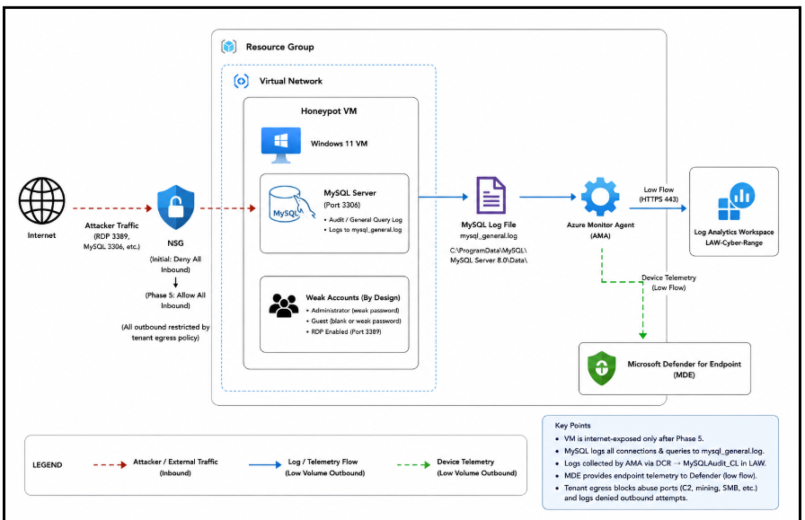

*Architecture of the Windows 11 and MySQL honeypot.*

## Phase 1: Build the Windows VM

I deployed `CORP-NA01-W11` with a public IP address. I kept inbound internet access blocked during setup.

After onboarding the VM to Microsoft Defender for Endpoint, I checked `DeviceInfo` to confirm that the device was reporting.

```kusto
DeviceInfo
| where DeviceName =~ "CORP-NA01-W11"
| project TimeGenerated, DeviceName, OSPlatform, OSVersion
| order by TimeGenerated desc
```

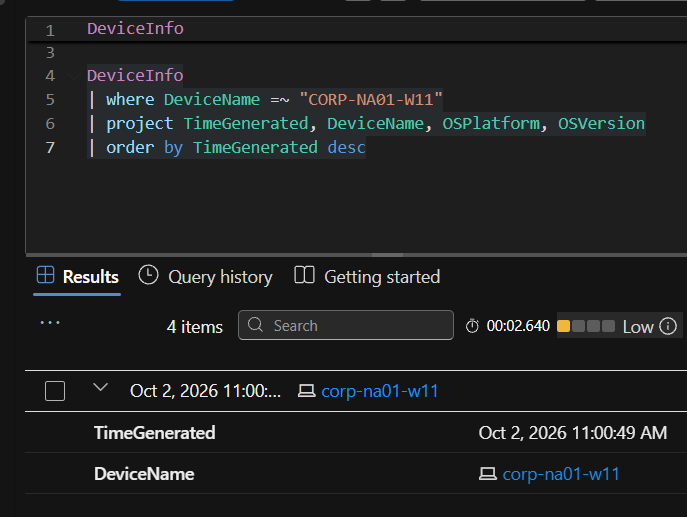

*`DeviceInfo` results show `corp-na01-w11` reporting to Defender.*

## Phase 2: Install and Populate MySQL

I installed MySQL Server 8.0 and MySQL Workbench. I opened `db_info_import.sql` in Workbench and ran the script to create the `lnp_corp` schema with synthetic business data.

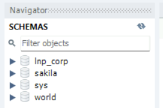

*The `lnp_corp` schema appears in MySQL Workbench.*

### Enable MySQL Logging

I enabled the general log and ran test queries in Workbench. I checked the log file to confirm that SQL activity was being recorded.

```sql
SET GLOBAL general_log = 'ON';
SET GLOBAL log_output = 'FILE';
SHOW VARIABLES LIKE 'general_log%';
```

Log file:

```text
C:\ProgramData\MySQL\MySQL Server 8.0\Data\mysql_general.log
```

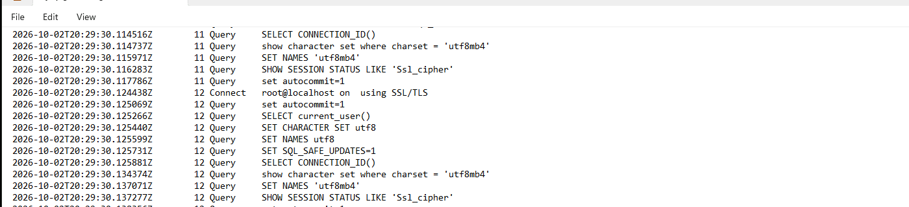

*The MySQL general log contains connection and query records.*

## Phase 3: Send Logs to Log Analytics

I configured Azure Monitor Agent and a Data Collection Rule to collect `mysql_general.log`. The records were sent to `MySQLAudit_CL` in `LAW-Cyber-Range`.

I used this query to check that the workspace was receiving logs from my VM.

```kusto
MySQLAudit_CL
| where _ResourceId endswith "CORP-NA01-W11"
| project TimeGenerated, RawData
| order by TimeGenerated desc
```

## Phase 4: Create Sentinel Rules

I created two scheduled rules. Both used a 10 minute frequency and a 10 minute lookback. Both were set to alert when the query returned more than zero results. The configuration grouped results into one alert and enabled suppression for one day.

### Windows Successful Logons

`Cyber-Defense-Final-corp-na01-w11-CH` monitored successful Administrator and Guest logons in `DeviceLogonEvents`. I mapped `DeviceName` as the host and `RemoteIP` as the IP address.

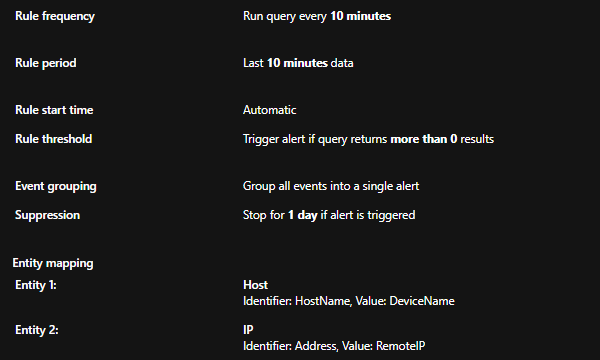

*Windows rule settings show the schedule, threshold, suppression, and entity mappings.*

### MySQL Successful Logons

`Cyber-Defense-Final-MySQL-CH` parsed `MySQLAudit_CL` for successful database logons. I mapped `DeviceName` as the host and `IpAddress` as the source address.

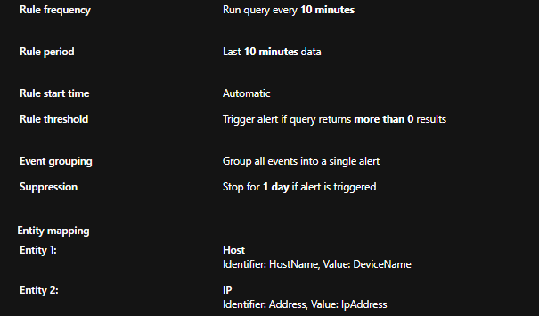

*MySQL rule settings show the same schedule and suppression period.*

## Phase 5: Weaken the Accounts

I configured Administrator with a weak password and enabled Guest with a blank password. I added Administrator to the Administrators group and Guest to the Users group.

I removed Guest from the local and RDP deny logon policies. I allowed remote logon and disabled the policy that restricts blank passwords to console access. I added both accounts to Remote Desktop Users and applied the policy with `gpupdate /force`.

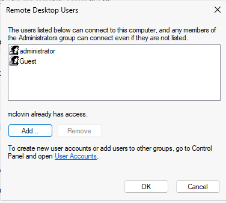

*Administrator and Guest are listed in Remote Desktop Users.*

### MySQL Remote Access

I created a MySQL root account that accepted remote connections. It used weak credentials and had administrative privileges for the controlled exposure.

### Capture the Baseline

Before exposure, I collected a Defender investigation package to preserve a baseline of the VM.

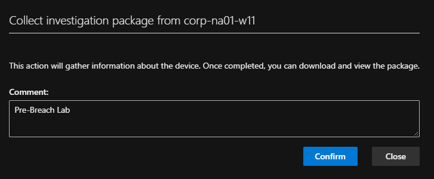

*Defender investigation package request for `corp-na01-w11`.*

### Open the Network Controls

I disabled Windows Defender Firewall on the Domain, Private, and Public profiles.

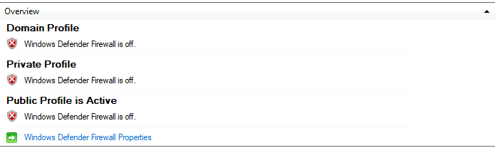

*All three Windows Firewall profiles are shown as off.*

I left the shared subnet NSG unchanged. On `CORP-NA01-W11-nsg`, I added `DANGER-Allow-All-Inbound` at priority 100 with any source, destination, port, and protocol.

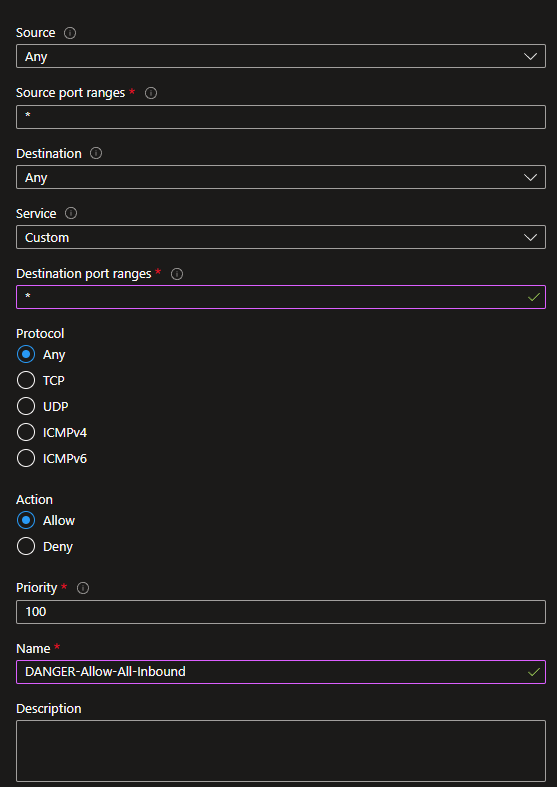

*The VM specific inbound rule is configured to allow all traffic.*

### Record the Exposure Time

I used the recorded exposure time as the starting point for hunting queries.

```text
2026-10-10T21:34:33.7873367Z
```

## Phase 6: Review Windows Authentication

I observed repeated failed Administrator logons before identifying successful external authentication.

### Successful Administrator Logons

I then filtered for successful Administrator logons. The results show external authentication from `183.82.33.208` and `77.36.113.9`. The events from `77.36.113.9` include `RemoteInteractive` logons, supporting remote desktop access.

```kusto
let MyDevice = "corp-na01-w11";
let ServerVulnerableDateTime = todatetime("2026-10-10T21:34:33.7873367Z");
DeviceLogonEvents
| where TimeGenerated > ServerVulnerableDateTime
| where DeviceName == MyDevice
| where AccountName =~ "administrator"
| where ActionType == "LogonSuccess"
| project TimeGenerated, RemoteIP, AccountName, DeviceName, ActionType, LogonType
| order by TimeGenerated asc
```

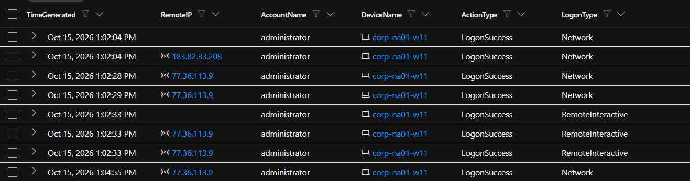

*Successful Administrator authentication, including `RemoteInteractive` events from `77.36.113.9`.*

## Phase 7: Trace MySQL Access

I matched the SQL connection IDs to their connection records in the same time window. Connections 35, 36, 37, and 38 show root connecting from `45.8.17.123`.

```kusto
let MyDevice = "corp-na01-w11";
let StartTime = datetime(2026-10-11 01:48:20);
let EndTime = datetime(2026-10-11 01:50:00);
MySQLAudit_CL
| where TimeGenerated between (StartTime .. EndTime)
| extend DeviceName = tostring(split(_ResourceId, "/")[-1])
| where DeviceName == MyDevice
| extend ConnectionId = extract(@"^\S+\s+(\d+)\s+", 1, RawData)
| where ConnectionId in ("35", "36", "37", "38")
| where RawData has "Connect"
| project TimeGenerated, ConnectionId, RawData
| order by TimeGenerated asc
```

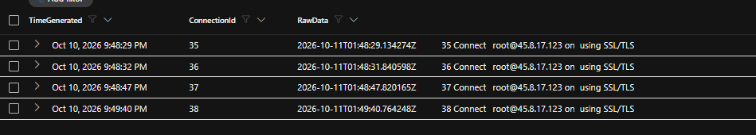

*The four MySQL connection records identify root@`45.8.17.123`.*

### Confirm the Network Connection

I searched Defender for the same IP. The result shows `InboundConnectionAccepted` on local port 3306, handled by `mysqld.exe`.

```kusto
let MyDevice = "corp-na01-w11";
let AttackerIP = "45.8.17.123";
let StartTime = datetime(2026-10-11 01:45:00);
let EndTime = datetime(2026-10-11 02:00:00);
DeviceNetworkEvents
| where Timestamp between (StartTime .. EndTime)
| where DeviceName == MyDevice
| where RemoteIP == AttackerIP
| project Timestamp, RemoteIP, RemotePort, LocalPort, ActionType,
    InitiatingProcessFileName
| order by Timestamp asc
```

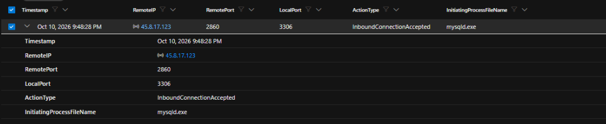

*Defender records `45.8.17.123` connecting to the MySQL service on port 3306.*

### Review the SQL Commands

I filtered `MySQLAudit_CL` for Query records to see which SQL commands were submitted after exposure. This query shows all SQL activity on the VM. I used the connection records to identify the external sessions.

```kusto
let MyDevice = "corp-na01-w11";
let ServerVulnerableDateTime = todatetime("2026-10-10T21:34:33.7873367Z");
MySQLAudit_CL
| where TimeGenerated > ServerVulnerableDateTime
| where RawData has "Query"
| extend RawData = replace_string(RawData, "\t", " ")
| extend DeviceName = tostring(split(_ResourceId, "/")[-1])
| where DeviceName == MyDevice
| extend ActionType = "Query"
| extend Query = split(RawData, "Query")[1]
| project TimeGenerated, DeviceName, ActionType, Query, RawData
| order by TimeGenerated asc
```

### Database Activity Linked to 45.8.17.123

The screenshot shows connection 36 issuing SELECT statements against credentials, customers, orders, and payments. Connection 35 issued commands to create `RECOVER_YOUR_DATA_info`, insert a recovery message, and drop business tables.

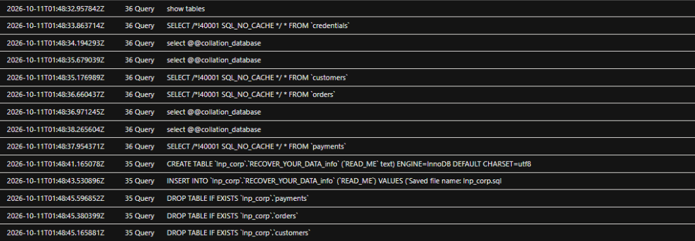

*SQL records from connections 35 and 36, which were linked to `45.8.17.123`.*

The timestamps place this activity around 01:48 UTC on October 11, 2026.

### Scope of the Review

Process and file searches around this MySQL activity returned no results.

## Phase 8: Containment

After the investigation, I isolated the VM through Microsoft Defender. I also collected an investigation package after the breach.

## Phase 9: Eradication and Recovery

I restored restrictive network settings and enabled Windows Firewall. I removed the weak Administrator account and disabled Guest.

I removed public MySQL access and the weak remote root configuration. I restored the database from the original synthetic dataset.

## Phase 10: Reporting

I documented the findings using the authentication, SQL query, and network records. I matched source IPs, connection IDs, and timestamps before linking database activity to a source.

| Evidence type | Purpose |
| --- | --- |
| `DeviceLogonEvents` | Windows authentication attempts and successful logons |
| `MySQLAudit_CL` authentication records | MySQL accounts, source IPs, and connection IDs |
| `MySQLAudit_CL` query records | SQL commands recorded during the exposure window |
| `DeviceNetworkEvents` | Connections to RDP and MySQL |

## Key Takeaway

The useful findings came from following the evidence. Windows logon results showed failed attempts and later successful authentication. MySQL records showed the database commands. Defender network events connected the source IP to the exposed MySQL service.
